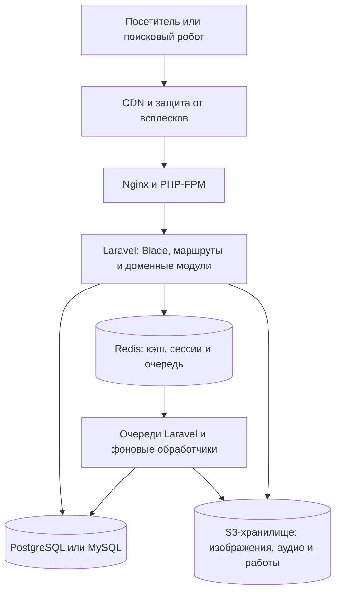

# Архитектура сайта «СказкоМир» на Laravel

**Версия документа:** 1.0  
**Назначение:** техническая основа для реализации сайта на Laravel с серверной вёрсткой, управляемым контентом, быстрыми каталогами и SEO-индексацией.

## 1. Короткое решение

Для первой версии подходит **модульный монолит**: одно Laravel-приложение, одна реляционная база данных и отдельные Redis, очередь задач и объектное хранилище для тяжёлых файлов. Это проще поддерживать, чем набор микросервисов, и позволяет разделять код по доменным областям.

Рекомендуемый стек:

| Область | Выбор для старта |
|---|---|
| Backend | Laravel 13, PHP 8.3+ |
| Шаблоны | Blade, HTML без клиентского рендеринга основного контента |
| Интерактивность | Alpine.js или небольшие модули vanilla JS; Vite для сборки |
| База данных | PostgreSQL 16+ либо актуальный MySQL 8.x; выбрать один и использовать его полнотекстовый поиск |
| Кэш, сессии, очереди | Redis |
| Файлы | S3-совместимое объектное хранилище + CDN |
| Web-сервер | Nginx + PHP-FPM |
| Панель управления | отдельная закрытая admin-зона; Filament можно взять как ускоритель, если подходит команде |

Laravel 13 требует PHP не ниже 8.3. Для production Laravel предлагает кэшировать конфигурацию, маршруты, события и Blade-представления командой `php artisan optimize`. 

### Принцип рендеринга

Главная, каталоги, страницы сказок, статей и раскрасок отдаются готовым HTML с сервера через Blade. Так контент виден без запуска JavaScript, страницы нормально работают на слабых устройствах и проще обходятся поисковыми роботами. JavaScript улучшает взаимодействия: плеер, очередь аудио, лайки интерфейса, фильтры без перезагрузки и рисование поверх PNG. Важные ссылки и пагинация всё равно остаются обычными `<a href>`.

Google умеет обрабатывать JavaScript, но в руководстве отдельно описывает ограничения этапов обхода и рендеринга; серверный HTML сокращает зависимость индексации от них. 

## 2. Состав приложения



На старте не нужны отдельные сервисы для каждого раздела. Модульные границы нужны внутри приложения, чтобы каталог сказок не зависел от интерфейса раскрашивания, а профили не содержали бизнес-логику комментариев.

### Слои приложения

1. **HTTP:** маршруты, middleware, контроллеры, авторизация запросов и ответы.
2. **Валидация:** `FormRequest` для фильтров, отзывов, входа, регистрации и загрузки работ.
3. **Доменные действия:** короткие классы действий для операций вроде публикации сказки, добавления закладки, отправки комментария на модерацию, загрузки аудио.
4. **Доступ к данным:** модели Eloquent, связи, query scopes и специализированные запросы каталогов. Не вводить универсальный Repository для каждой модели без реальной необходимости.
5. **Представление:** Blade-компоненты общего каркаса, карточки, хлебные крошки, фильтры, аудиоплеер и SEO-блоки.
6. **Фоновые задачи:** jobs для обработки картинок, проверки метаданных аудио, обновления sitemap, писем и поискового индекса.

## 3. Разделение доменов

```text
app/
  Domain/
    Stories/       # сказки, жанры, читательская страница
    Audio/         # аудиозаписи, очередь, метаданные
    Coloring/      # категории, листы, пользовательские работы
    Activities/    # викторины, логические задачи, отличия
    Journal/       # статьи для родителей, авторы, рубрики
    Community/     # отзывы, комментарии, реакции, модерация
    Accounts/      # профиль, полка, история, социальные входы
  Http/
    Controllers/
    Requests/
    Middleware/
  Jobs/
  Policies/
  Support/Seo/
resources/views/
  layouts/
  components/
  pages/
routes/web.php
```

Модуль — это организация кода, не отдельный Laravel-пакет. Если позднее один домен действительно потребует самостоятельного масштабирования, границу можно будет вынести, не начиная с распределённой системы.

## 4. URL и страницы

Адреса должны быть стабильными, читаемыми, в нижнем регистре и не зависеть от ID записи. Slug хранится в базе; смена опубликованного slug создаёт 301 redirect со старого адреса.

| Страница | Пример URL | Индексация |
|---|---|---|
| Главная | `/` | индексировать |
| Каталог сказок | `/skazki` | индексировать |
| Сказка | `/skazki/kolobok` | индексировать при наличии полезной страницы |
| Чтение | `/skazki/kolobok/chitat` | определить одну каноническую страницу с полным текстом; не плодить копии текста |
| Каталог аудио | `/audio-skazki` | индексировать |
| Аудио отдельной сказки | `/audio-skazki/kolobok` | отдельная страница только если есть собственная ценность: запись, длительность, описание и управление |
| Категории раскрасок | `/raskraski` | индексировать |
| Категория | `/raskraski/zhivotnye-i-druzya` | индексировать, если есть реальные работы и уникальное описание |
| Раскраска | `/raskraska/domiki-treh-porosyat` | индексировать при наличии текстового описания и полезной страницы |
| Редактор раскраски | `/raskraska/domiki-treh-porosyat/raskrasit` | обычно `noindex`; это инструмент, не поисковая посадочная |
| Журнал для родителей | `/roditelyam` | индексировать |
| Статья | `/roditelyam/kak-chitat-vmeste` | индексировать |
| Занятия | `/zanyatiya`, `/zanyatiya/logika` | индексировать каталоги с содержанием |
| Поиск | `/poisk?q=...` | `noindex,follow` |
| Вход и регистрация | `/vhod`, `/registraciya` | `noindex` |
| Профиль, полка, история | `/kabinet/...` | `noindex`; закрытая авторизованная зона |

Фильтры отправляются GET-параметрами, например `/skazki?vozrast=3-5&zhanr=narodnye`. Индексируются только заранее выбранные содержательные категории. Комбинации фильтров, сортировки, поиска и бесконечные параметры получают canonical на базовый каталог или `noindex,follow` согласно SEO-правилу. Не оставлять роботу бесконечное множество URL.

Пагинация — серверная: ссылки `<a href="?page=2">`, отдельный URL страницы, правильная сохранность фильтров, canonical на саму страницу пагинации. Не делать пагинацию только кнопкой, которая меняет содержимое через JS: Google в основном обнаруживает ссылки по `href`, а не кликает кнопки. 

## 5. Маршруты Laravel

```php
// routes/web.php — схема, имена условные
Route::get('/', HomeController::class)->name('home');
Route::get('/skazki', [StoryController::class, 'index'])->name('stories.index');
Route::get('/skazki/{story:slug}', [StoryController::class, 'show'])->name('stories.show');
Route::get('/skazki/{story:slug}/chitat', [ReaderController::class, 'show'])->name('stories.read');
Route::get('/audio-skazki', [AudioController::class, 'index'])->name('audio.index');
Route::get('/audio-skazki/{story:slug}', [AudioController::class, 'show'])->name('audio.show');
Route::get('/raskraski', [ColoringCategoryController::class, 'index'])->name('coloring.index');
Route::get('/raskraski/{category:slug}', [ColoringCategoryController::class, 'show'])->name('coloring.categories.show');
Route::get('/raskraska/{coloring:slug}', [ColoringPageController::class, 'show'])->name('coloring.show');
Route::get('/roditelyam', [ArticleController::class, 'index'])->name('articles.index');
Route::get('/roditelyam/{article:slug}', [ArticleController::class, 'show'])->name('articles.show');
Route::get('/poisk', SearchController::class)->name('search');

Route::middleware('auth')->prefix('kabinet')->name('account.')->group(function () {
    Route::get('/', [ProfileController::class, 'show'])->name('profile');
    Route::get('/polka', [LibraryController::class, 'index'])->name('library');
    Route::get('/istoriya', [ReadingHistoryController::class, 'index'])->name('history');
});
```

Публичные действия вроде отправки комментария, лайка или загрузки фотографии — отдельные POST-маршруты с `auth`, CSRF, `FormRequest`, policy и rate limit. Не менять данные GET-запросом. В аудиофайлах браузеру нужно дать возможность запрашивать диапазоны байтов для перемотки; сам MP3 отдавать через CDN/файловое хранилище, не читать весь файл в PHP-память.

## 6. Модель данных

Все даты хранить в UTC. Публичный контент имеет явный статус (`draft`, `review`, `published`, `archived`) и дату публикации. В выдачу каталогов попадают только опубликованные записи.

| Таблица | Ключевые поля и связи |
|---|---|
| `stories` | `id`, `slug` unique, `title`, `author_name`, `summary`, `body`, `age_from`, `age_to`, `reading_minutes`, `cover_media_id`, `status`, `published_at`, SEO-поля |
| `genres` | `id`, `name`, `slug` unique; связь many-to-many `story_genre` |
| `audio_tracks` | `story_id`, `disk`, `path`, `duration_seconds`, `bytes`, `mime_type`, `is_public`, `status`; история может иметь разные аудиоверсии |
| `coloring_categories` | `name`, `slug`, `description`, `cover_media_id`, `sort_order`, `status` |
| `coloring_pages` | `category_id`, опциональный `story_id`, `slug`, `title`, `description`, `outline_media_id`, возраст, сложность, статус |
| `articles` | `slug`, `category_id`, `author_id`, `title`, `excerpt`, `body`, `reading_minutes`, публикация, SEO-поля |
| `activity_categories`, `activities` | категория, тип (`quiz`, `logic`, `differences`), slug, возраст, сложность, инструкции |
| `quiz_questions`, `quiz_answers` | вопрос, порядок, варианты ответа, признак правильного ответа; ответы валидируются сервером |
| `users` | имя, email unique, пароль, подтверждение email, настройки профиля |
| `social_accounts` | `user_id`, провайдер (`yandex`, `vk`), provider user ID; unique(provider, provider_user_id) |
| `comments` | polymorphic target (`commentable_type/id`), `user_id`, `parent_id`, текст, статус модерации, даты |
| `comment_reactions` | `comment_id`, `user_id`, тип; unique(comment_id, user_id), чтобы пользователь не накручивал реакции |
| `coloring_works` | `coloring_page_id`, `user_id`, изображение, подпись, статус модерации, даты |
| `work_reactions` | `work_id`, `user_id`, тип реакции; уникальность пары |
| `user_bookmarks` | `user_id`, тип сущности, ID сущности; уникальность пары |
| `reading_sessions` | `user_id`, `story_id`, начало, завершение/прогресс, источник; для истории профиля |
| `media_assets` | disk/path, MIME, размер, ширина/высота, alt, контрольная сумма, производные изображения |
| `slug_redirects` | старый URL unique, целевой URL, код 301 |

**Важные индексы:** unique на slug; `(status, published_at)` на историях и статьях; `(category_id, status, sort_order)` на раскрасках; внешние ключи во всех pivot-таблицах; `(commentable_type, commentable_id, status, created_at)` у комментариев; `(user_id, created_at)` у истории чтения; индексы фильтруемых полей возраста и сложности. Индексы подтверждать через `EXPLAIN ANALYZE` на реальных выборках, а не добавлять без проверки.

Текущие рейтинги рассчитывать из одобренных оценок. Счётчики можно хранить денормализованно только при корректном обновлении в транзакции или очереди; источник истины — таблицы оценок и реакций. Никогда не размечать выдуманные рейтинги как настоящие.

## 7. Поиск и каталоги

### Первая версия

- Фильтры и сортировки реализовать серверными GET-параметрами и SQL scopes.
- Для поиска начать с полнотекстового индекса выбранной базы, плюс поиск по заголовку и автору.
- Если используются PostgreSQL и стандартный `russian` text-search configuration, отдельно проверить морфологию и качество словаря на настоящих запросах пользователей.
- Не загружать весь каталог и не фильтровать его в браузере.
- Пагинировать сервером: обычная `paginate()` для страниц каталога, `cursorPaginate()` для длинных лент пользовательских работ/комментариев.
- Выбирать только поля карточек, `with()` для связанных автора, категории и обложки; агрегаты — через `withCount()`.

### При росте

Когда логирование запросов покажет, что реляционного поиска недостаточно, подключить Laravel Scout с поисковым движком (например, Meilisearch). Индексировать только опубликованные записи; обновление индекса — job. База остаётся источником истины. Не добавлять поисковый сервер просто «на будущее».

## 8. Кэширование и скорость

### Слои кэша

1. **CDN:** CSS, JS, шрифты, обложки, PNG, WebP/AVIF и публичные MP3. Immutable-файлы получают долгий TTL и имя с хэшем версии.
2. **HTTP-кэш HTML:** только для анонимных публичных страниц. Вход, профиль, ответы с персональными данными и формы с CSRF-токеном обходят shared cache.
3. **Redis application cache:** результаты популярных каталогов, блоки главной, счётчики и редко меняющиеся справочники.
4. **Кэш Laravel при деплое:** `php artisan optimize`, с очисткой/прогревом контролируемых продуктовых ключей отдельно.

Ключи продуктового кэша включают версию схемы/контента, язык, категорию, фильтры, сортировку и номер страницы. TTL выбирать по частоте обновления: каталоги — минуты, долгие статьи и записи — дольше. Инвалидация при публикации или изменении записи должна сбрасывать конкретную страницу, связанные категории, страницу сайта и sitemap, а не весь Redis.

Пользовательские блоки, избранное, очередь плеера, статусы модерации, авторизованные страницы и flash-сообщения никогда не смешивать с публичным кэшом. Не использовать `Cache::rememberForever()` без механизма обновления.

### Профилактика медленных запросов

- На каталогах измерять число SQL-запросов и запрещать N+1 в тестовом окружении.
- Запросы к карточкам имеют фиксированный `select`; использовать eager loading.
- Для больших коллекций не вызывать `get()` без лимита; пределы страницы валидировать.
- Поиск, сортировку, фильтры и агрегаты выполнять в БД, а не в PHP на полном наборе.
- Для изображений генерировать responsive-размеры, задавать `width`/`height`, загружать отложенно ниже первого экрана. Главное изображение первого экрана не lazy-load.
- Не загружать плеер и редактор раскраски целиком на страницах, где они не нужны.
- Метрики вести раздельно: TTFB, SQL p95, запросы на страницу, кэш hit ratio, размер HTML, LCP/INP/CLS.

## 9. Очереди и медиа

Фоновые очереди Redis:

- `media`: проверка MIME/размера, создание миниатюр WebP/AVIF, удаление EXIF из пользовательских изображений;
- `search`: обновление поискового индекса;
- `sitemap`: обновление sitemap после публикаций, а не на каждом запросе;
- `mail`: подтверждение email, сброс пароля, уведомления;
- `default`: остальные задачи.

Для пользовательских фотографий: проверять настоящий MIME содержимого, лимит размера и разрешение, генерировать случайное имя, хранить вне публичного исполняемого каталога, модерировать до публикации. Оригиналы и производные — в object storage. Удаление пользователя/работы должно удалять или обезличивать связанные данные по выбранной продуктовой политике.

Для аудио: в БД хранить объект и метаданные, браузеру отдавать CDN URL или корректный файловый response с `Accept-Ranges`. Плеер начинает воспроизведение без скачивания файла целиком; обработка метаданных выполняется асинхронно. В админке предусмотреть состояние «аудио загружено/проверено/опубликовано».

## 10. SEO и индексация

SEO не сводится к meta-тегам. Основа — самостоятельные полезные страницы, понятные внутренние связи и доступный HTML. Google прямо рекомендует ориентироваться на people-first content; массовые страницы с повторяющимися текстами не являются хорошей стратегией. 

### Для каждой публичной страницы

- уникальные `<title>` и `meta description`, один понятный H1, короткий человекочитаемый URL;
- серверно отрендеренный основной текст, иллюстрация с подходящим alt, хлебные крошки и ссылки на похожие материалы;
- canonical абсолютным URL на версию страницы, которую нужно индексировать;
- Open Graph для превью при распространении;
- 404 для отсутствующей записи; 301 для переезда slug; не отдавать `200` для пустого результата как будто это полноценная страница;
- точные даты публикации/обновления и видимый автор/редактор статьи;
- для сказки — описание, возраст, автор/источник, время чтения и оговорённые права на текст/иллюстрацию;
- для аудио — отдельное описание записи и ссылка на оригинальную страницу сказки, если аудиостраница действительно уникальна.

### Sitemap и robots

- Создавать XML sitemap по опубликованным каноническим URL; при росте разделить на sitemap сказок, статей, раскрасок и изображений и добавить sitemap index.
- Использовать `lastmod` только когда публичный контент действительно изменился.
- Исключать черновики, закрытый кабинет, результаты внутреннего поиска и технические URL.
- В `robots.txt` указать URL sitemap. Не закрывать CSS, JS и нужные изображения от роботов.
- Отправить sitemap в Google Search Console и Яндекс Вебмастер; проверять отчёты покрытия/индексации и серверные ошибки.

Google рекомендует включать в sitemap предпочтительные canonical-URL, а Яндекс принимает XML sitemap и позволяет указать его в `robots.txt`. 

### Schema.org

Генерировать JSON-LD из тех же данных, что видит посетитель. Базовые типы: `Organization`/`WebSite`, `BreadcrumbList`, `Article` для статей; `Book` и `AudioObject` как описательная семантика для соответствующих материалов. Не обещать расширенный сниппет: Google отображает специальные результаты только для поддерживаемых типов, а разметка должна соответствовать видимому содержимому. Для breadcrumb-разметки применять официальную спецификацию Google. JSON-LD Google рекомендует как удобный формат. 

Не размечать отзывы, звёзды, FAQ, авторов или даты, которых нет на странице. Не создавать искусственные комментарии для SEO.

### Контентная архитектура

- До наполнения составить карту запросов: сказки, аудиосказки, чтение по возрасту, конкретные раскраски, занятия и статьи для родителей.
- Одна целевая страница — один основной интент. Не делать отдельную страницу под каждую комбинацию фильтров.
- У карточки/страницы раскраски должны быть название, оригинальный рисунок, сложность, возраст, краткая инструкция, удобные действия (скачать/распечатать/раскрасить) и при необходимости реальные примеры работ.
- Статьи редакционного раздела должны содержать практический опыт, автора и источники там, где они нужны.
- План публикаций, редакторская проверка и права на произведения важнее автоматической генерации сотен похожих URL.

## 11. Структурный SEO-шаблон Blade

```blade
<title>{{ $seo->title }}</title>
<meta name="description" content="{{ $seo->description }}">
<link rel="canonical" href="{{ $seo->canonicalUrl }}">
<meta property="og:title" content="{{ $seo->title }}">
<meta property="og:description" content="{{ $seo->description }}">
<meta property="og:image" content="{{ $seo->imageUrl }}">
<script type="application/ld+json">{!! $seo->jsonLd() !!}</script>
```

Данные `$seo` создаёт серверная SEO-служба из текущей модели и маршрута. Экранировать обычные значения через Blade; JSON-LD сериализовать безопасным `json_encode` с флагами для защиты от HTML-контекста, не собирать JSON строковой конкатенацией.

## 12. Безопасность и детский контент

- Авторизация через email/пароль; OAuth для Yandex и VK через отдельные адаптеры провайдеров. Не привязывать аккаунты только по совпадающему email без проверенного сценария подтверждения.
- Laravel Policies на полку, профиль, редактирование работ и модерацию. Роли: `user`, `moderator`, `editor`, `admin`; разрешения назначаются ролям и проверяются middleware/policy.
- Form Request для всех входных данных; Blade escaping; CSRF; rate limiting на вход, поиск, комментарии и реакции; строгая проверка файлов.
- Публичные комментарии и детские фотографии проходят очередь модерации. Не выводить email, полные имена или приватные данные пользователя.
- Пароли хранить только через штатный безопасный hash Laravel; сброс — одноразовый токен с ограниченным сроком.
- Секреты OAuth и БД — в переменных окружения/secret manager, никогда в репозитории.
- Включить HTTPS, безопасные cookie, резервное копирование БД и медиа, аудит действий редакторов и план восстановления.

## 13. Панель редактора

Минимальные разделы: сказки, авторы и жанры; MP3 и обложки; категории/раскраски; статьи и авторы; викторины и задачи; комментарии/пользовательские работы на модерации; SEO-поля и redirects; пользователи и роли.

Сценарий публикации: автор заполняет запись → проверка обязательных полей и прав → предпросмотр конечного URL/метаданных → публикация → очистка адресно связанных кэшей → обновление sitemap и поиска через очередь. Удаление опубликованной записи должно вести на 301-замену или 404/410 согласно редакционному решению.

## 14. Деплой и окружения

Окружения: `local`, `staging`, `production`; для каждого отдельная база, Redis, объектное хранилище и OAuth credentials. Не копировать production-персональные данные в тестовую среду.

Пример шага релиза:

```bash
composer install --no-dev --prefer-dist --optimize-autoloader
npm ci
npm run build
php artisan migrate --force
php artisan optimize
php artisan queue:restart
```

Перед переключением релиза: health check приложения, проверка подключения к БД/Redis, доступности MP3 по Range, наличие нужных файлов. Для надёжного отката использовать релизные каталоги/атомарное переключение symlink; миграции проектировать совместимыми с текущим и предыдущим релизом. После деплоя проверить главную, каталоги, карточку сказки, sitemap, авторизацию и очередь ошибок. Laravel рекомендует выполнять оптимизацию cache-артефактов при production deployment. 

## 15. Проверки и целевые показатели

| Проверка | Начальная цель |
|---|---|
| LCP | не более 2,5 с на 75-м перцентиле реальных визитов |
| INP | не более 200 мс на 75-м перцентиле |
| CLS | не более 0,1 на 75-м перцентиле |
| Ошибки 5xx | мониторить; уведомлять при любом устойчивом росте |
| SQL | отсутствие N+1; p95 и количество запросов отслеживаются по странице |
| Поисковая доступность | содержимое и canonical видны в исходном HTML; страницы тестируются в инструментах вебмастеров |
| Медиа | изображения имеют производные размеры; MP3 перематывается; пользовательские загрузки проверяются и модерируются |

Значения Core Web Vitals — целевые пороги хорошего пользовательского опыта, а не гарантия позиций в поиске. 

Перед релизом нужны feature-тесты маршрутов/прав, тесты фильтров и пагинации, тесты загрузки и модерации, Laravel Pint, анализ зависимостей, smoke-тесты после деплоя. Нагрузочный профиль строить по фактической посещаемости; не объявлять систему «без лагов» без нагрузочного теста на выбранном сервере.

## 16. План разработки по этапам

1. **Основа:** Laravel, база, Blade layout, дизайн-токены, auth, роли, staging и CI.
2. **Публичная библиотека:** сказки, каталоги, чтение, фильтры, canonical, sitemap, базовые SEO-компоненты.
3. **Аудио и медиа:** загрузка MP3, Range/ CDN, плеер/очередь, обработка обложек, метаданные.
4. **Занятия и журнал:** категории раскрасок, редактор canvas, задачи/викторины, статьи.
5. **Профиль и сообщество:** полка, история, избранное, комментарии, реакции, фото работ и модерация.
6. **Оптимизация:** Redis-кэш по измерениям, очереди, нагрузочный тест, CWV, Search Console и Яндекс Вебмастер.

Не подключать Scout, Octane, микросервисы или сложный full-page cache до появления измеренной проблемы. Сначала SSR, запросы с индексами, CDN для файлов, Redis для горячих данных и профилирование.

## 17. Критерии готовности к запуску

- Все публичные страницы имеют устойчивый URL, корректный title/description/canonical и реальный уникальный контент.
- Каталоги фильтруются и пагинируются на сервере; неважные комбинации фильтров не раздувают индекс.
- Sitemap содержит только опубликованные канонические страницы; robots не блокирует рендер-ресурсы.
- Ошибочные slug дают 404, переезды — 301, удалённые материалы обрабатываются осознанно.
- Основные изображения не сдвигают макет, имеют размеры и alt; MP3 отдаётся без загрузки всего файла в память PHP.
- Авторизованные данные и пользовательские страницы не попадают в публичный кэш.
- Есть бэкапы, мониторинг, модерация UGC и план отката релиза.
- CWV, ошибки 5xx и тяжёлые SQL-запросы проверяются после запуска по реальным данным.

## Источники

- [Laravel 13 Release Notes](https://laravel.com/docs/13.x/releases)
- [Laravel Deployment: оптимизация production](https://laravel.com/docs/13.x/deployment)
- [Laravel Cache](https://laravel.com/docs/13.x/cache)
- [Google Search: основы SEO](https://developers.google.com/search/docs/fundamentals/seo-starter-guide)
- [Google Search: полезный контент](https://developers.google.com/search/docs/fundamentals/creating-helpful-content)
- [Google Search: JavaScript SEO](https://developers.google.com/search/docs/crawling-indexing/javascript/javascript-seo-basics)
- [Google Search: canonical URL в sitemap](https://developers.google.com/search/docs/crawling-indexing/sitemaps/build-sitemap)
- [Google Search: pagination и обнаружение ссылок](https://developers.google.com/search/docs/specialty/ecommerce/pagination-and-incremental-page-loading)
- [Google Search: BreadcrumbList](https://developers.google.com/search/docs/appearance/structured-data/breadcrumb)
- [Google Search: JSON-LD и структурированные данные](https://developers.google.com/search/docs/appearance/structured-data/intro-structured-data)
- [web.dev: Core Web Vitals](https://web.dev/articles/vitals)
- [Яндекс Вебмастер: Sitemap](https://yandex.com/support/webmaster/en/controlling-robot/sitemap)
- [Яндекс Вебмастер: robots.txt](https://yandex.com/support/webmaster/en/controlling-robot/robots-txt)
